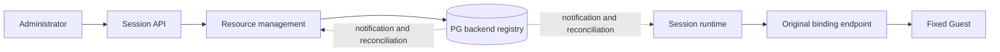

# Resource backends

The administrator registers an existing Cube or BoxLite endpoint from the
administration page. This does not install a cluster or create a network path.
The resource page offers registered Linux backends, environment templates and
profiles. An open page refreshes the catalog automatically, including when it
has no development machines yet.

This source slice is tracked in #31 / ADR-0319. Matched publication and the live
second-backend acceptance are still pending; do not infer them from unit tests.

## Registration and admission

Supply a stable backend ID, display name/location, native endpoint/credential,
storage endpoint/credential and the installed fixed-Guest templates. Cube also
needs its ordinary proxy address/domain. BoxLite needs its node identity. Storage
pool identity is read from the authenticated storage endpoint; API callers may
also supply an expected identity to detect a mistaken endpoint.

Registration verifies authenticated native reads, the native adapter protocol,
template readiness/capacity and storage pool identity. The fixed Guest revision
must match the current platform contract. A matching revision string does not
replace the actual Guest initialization checks on allocation.

PG commits the revision, encrypted private configuration and separate public
catalog before acknowledging. No native credential or private endpoint is sent
to a user catalog, Worker or model. A repeated identical request is idempotent;
a stale conflicting revision is rejected. The creation transaction locks and
rechecks the selected backend/template/profile and records its Workspace
selection. Internal callers that omit a selection retain automatic domain
placement; a default template is frozen before its first native allocation.

Both `POST /v1/projects` (an elastic Workspace) and development-machine creation
accept the same explicit `backend: { id, templateId, revision }` selection. The
Resources page exposes it for both paths.

The public request is `PUT /v1/resource-backends` for the platform administrator.
`GET /v1/resource-backends` is the user catalog; `/admin` also lists disabled
backends. `configuration.templates` can contain multiple named environments.
Adding compatible templates through the same versioned API is dynamic. The first
Web registration form supplies one Linux environment and the three supported
resource profiles. Existing environment/connection edits use the versioned API.

## Running services

Management creates the existing per-domain lifecycle controllers behind one
listener. Execution creates data clients only. Binding and capsule targets retain
the original native endpoint; ordinary Tool dispatch finds that client in memory.
A cold directory lookup may reconcile PG. It never checks a Worker lease, creates
a VM or rewrites an old target. One unavailable new backend does not replace the
other domains' controllers or clients.

Notifications are hints. Periodic revision reconciliation and cold lookup recover
missed updates. No process restart, source-code loader, second scheduler or second
Session consumer is introduced by registration. New native protocols still need
a trusted adapter implementation and its own acceptance.

## Changes and retirement

Active/draining/disabled controls new allocations. Disabling does not delete
resources, prove their absence or release quota. Existing managed resources retain
their lifecycle/data paths. Names, state and compatible template additions do not
restart controllers. Template display names and operating-system labels are
presentation metadata; changing them preserves existing allocations. The initial
deployment advertises the fixed Guest as Linux without guessing a distribution
version. Replacing an existing template's executable identity requires physical allocation
quiescence while retaining Workspace files. Endpoint/credential/storage changes
require the affected backend's retained resources and Workspaces to be released;
live endpoint migration is outside this first contract. Lifecycle admission checks
the loaded registry revision while holding the existing domain transaction lock.

Registry removal is not an implicit cleanup operation. The administrator first
stops new allocation, releases resources through their normal API and confirms
physical cleanup. Missing health or registration activity is never that proof.

## Android and placement

Android uses the existing device-target authority, not a Linux volume/VM facade.
The administrator registers an already-running compatible device executor using
its actual UUID and endpoint. `POST /v1/resource-backends/devices` relays this to
management under the platform credential. Its body is
`{ tenantId, device: { targetId, name, endpoint } }`: the administrator explicitly
selects the device's organization instead of assigning it to the admin account.
The existing operator CLI uses the same
registration code. This creates no emulator, Workspace or device access scheduler.
The Resources page lists registered devices and can connect/disconnect an idle
conversation using the existing Session revision checks. A listed registration
does not claim the device is online. Device state retains its own lifetime.

Local Workspace storage is still local. Identical path names on different nodes
are not the same pool; attachment verifies the pool/generation from ADR-0318.
Registration cannot create shared storage, route across a disconnected network,
or make untested hosted-provider persistence guarantees true. The supported Web
form and protocol distinguish those limits from actual provisioned capabilities.
