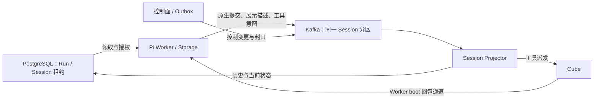

# ADR-0246: Worker direct Kafka publication — proposal

Status: **proposed for discussion, not accepted or implemented**, 2026-10-13.
Source baseline: `29fedca5`. ADR-0209 remains the current production contract.
The owner requested a concrete change assessment after the
[native Kafka experiments](../reports/kafka-native-fencing-20261013.md).
This document authorizes no migration, deployment or runtime fallback.

## Objective and assessment

让 Worker 的原生日志提交直接得到 Kafka 确认，减少控制面普通重启、兼容更新对
正在运行的 Pi Harness 的影响。保留 PG 的执行授权、同一物理 Session 单写者、
原生 Durable 恢复、封口、一个 Projector 消费组及现有 Cube 工具边界。

这是发布与关闭协议的改动，不是把 HTTP 调用替换为 `producer.send()`。
主要收益是数据路径解耦；不能据此承诺工具派发、PG 投影和网页展示在控制面
停机时仍能持续进展，也不能承诺新的实现一定比现有代码少。

主候选采用**每个活跃物理 Session 一个稳定的 Kafka 事务生产者身份**，将普通
发布放在 Worker。控制面保留控制记录发布与故障封口能力。该候选具备可行的
原生基础，但只有下述关闭和恢复验收通过后才建议切换。

## Proposed topology

图中的控制面与 Projector 仍在同一个部署进程内。Worker 直写不表示这个 Topic
只能有 Worker 写入；控制面仍是绑定变更、执行关闭等控制事实的来源。
不新增队列、消费组租约、Broker 服务、RunAttempt 或工具结果数据库。

## Identity and ordinary publication

1. PG 继续签发物理 Session 租约及 epoch，确定 Worker/boot、Run、Conversation
   和 writerId。Kafka key 仍是物理 Session ID，固定分区规则不变。
2. Kafka 事务 ID 固定关联 `topic + tenant + physicalSessionId`。
   **不包含 leaseId、PG epoch 或 Worker bootId**，否则替换者无法隔离前任。
3. 首个 Run 打开物理 Session 时初始化事务生产者；初始化完成后，必须使用一次
   **新的 PG 查询**核实完整身份、租约有效期、writer 关闭状态以及 Run 授权。
   不能用 `PostgresSessionLeaseObserver` 尚未过期的本地缓存代替这次检查。
   初始化前可以先拒绝已知失效身份，以避免无意义地影响当前生产者，但它不替代
   初始化后的检查。这里不持有 PG 事务/行锁等待 Kafka 网络请求。
4. 检查失败即销毁该生产者，不能开始模型请求或发布数据。每次重建生产者都适用
   同一规则；不得做无授权检查的自动重新初始化。
5. 同一物理 Session 的子 Run 共享生产者、Storage seq 分配和发布串行边界。
   每个 Run 仍有自己的执行授权与取消范围，不创建子 Run 的生产者或租约。
6. 普通提交保留完整原生 batch、图片引用、origins、工具意图、取消和展示描述。
   同一批只写一条 Kafka record。原生 Storage 收到 RF3/事务 ACK 后才采用状态；
   不增加逐批 PG 收据或把完整 batch 再写入 PG Outbox。
7. 普通追加使用 Worker 已安装的授权状态及现有租约观察机制，不要求每批查 PG。
   Kafka 事务只覆盖一次短发布，绝不跨越模型生成、工具执行或整个 Run。
8. 活跃 Session 最后一个 Run 退出且写入收尾后释放生产者。冷会话不保留连接、
   线程或 producer；现有资源压力与传输背压仍生效。

隔离实验已经证明：仅增加初始化后的 PG 检查仍会发生“旧初始化先隔离了当前
合法生产者，然后才被 PG 拒绝”。本提案接受需要处理这个可用性事件，不把它
误称为已彻底消除的竞争，也不把 Kafka epoch 当作 PG 执行授权。

## Two publication roles

| 发布角色 | 使用者 | 作用 |
| --- | --- | --- |
| 物理 Session 事务生产者 | 当前 Worker；整 writer 故障关闭时由控制方临时接管 | 原生数据提交、隔离失效 writer |
| 控制记录生产者 | 当前 Projector 分区拥有者 | 普通 Run seal、绑定等控制变更、已经建立 writer 关闭边界后的后续控制记录 |

控制记录生产者可以继续复用现有按分区事务身份及消费组代次校验；Worker 的数据
生产者不借用 Projector 的消费组元数据，也不提交 Projector 的派发 offset。
控制面副本间必要的控制消息路由保留，但没有 Worker 普通日志的 HTTP 中转。

两个角色不共同分配 Pi seq，不是两个原生日志写者。控制记录不进入 Pi 上下文。

## Normal Run closure

正常完成/取消单个 Run 时，不抢占物理 Session 的 Kafka 事务身份。

1. Worker 关闭该 Run 的新发布入口，切换后续原生提交的有效 Run anchor，并等待
   已接收、涉及该 Run 的原生/展示/工具/取消发布到达确定的 ACK 边界。
   实现要审计物理 Session 队列与现有 Run 队列的关系，不能只等一个局部队列就
   宣称共享 batch 已排空，也不能等待兄弟 Lane 自然结束。
2. 只有确认上述收尾，才在现有 PG Run 上记录 `native_output_drained` 和已确认
   展示进度。PG 事务按现有流程登记 Run terminal 与不可变 seal Outbox。
3. 控制记录生产者将 `closesWriter=false` 的 seal 写到同一 Session 分区。
   因果顺序为：Run 数据 Kafka ACK → PG 排空证据/封口意图 → seal Kafka 提交。
4. 兄弟 Lane 继续使用原来的 Session 生产者。原生日志 batch 保持不可拆分；
   不能通过删除关闭 Lane 的部分写入来让一个混合 batch 通过。

这条跨生产者的因果顺序替代了当前入口的共享内存队列。必须用真实并发测试证明，
不能仅凭“同一个 Kafka key”断言有这个顺序。无法证明已排空时进入整 writer
关闭流程，不能伪造 `native_output_drained=true`。

## Failed physical writer closure

整 Session writer 失效、提交不确定或 Worker 被替换时，关闭范围仍覆盖其所有
Lane；保留现有 immutable Outbox 清理目标与按节点确认资源的规则。

1. PG 标记原租约的 writer 失效、禁止新执行授权，持久化精确封口意图。
   在最终 seal 之前撤销工具路由资格；取消 ACK 或探针失联不证明物理进程停止。
2. 当前 Projector 分区拥有者负责控制发布，在同一物理 Session 内串行处理这些
   关闭请求。PG Outbox 仍是持久化来源，不另建 producer lease 或分布式锁表。
3. 若 PG 尚无这个 writer 的关闭位置，控制方临时初始化相同 Session 事务 ID，
   隔离旧生产者并让其未决事务完成或中止。**初始化之后再核实 Outbox、旧 writer
   和当前控制分区归属**；若已经完成关闭或请求已失效，不能再提交旧关闭工作。
4. 用这个临时生产者写入第一条有效的 `closesWriter=true` seal，事务绑定控制方
   当前消费组元数据。Projector 按现有规则保存原生 live 交接检查点和最早 writer
   关闭位置。
5. PG 已证明 writer 关闭后，其他 Run 的精确 seal 与重复控制工作由控制记录
   生产者处理，避免为每一个子 Run seal 再抢一次 Session 事务身份。
   重试先检查已完成的 PG 证据；丢失控制 ACK 可以重试同一个幂等控制事实，
   不能重新发原生数据或任意 Shell 意图。
   同一个 Run 恢复后会清空旧的 `output_seal_id` 等字段，重复旧 seal 必须依据
   历史 writer 关闭证据识别完成，不能因当前 Run 已绑定新身份而无限重试或改写它。
6. 保留 `SessionLeaseCoordinator` 的现有要求：所有必要 Run seals 都投影完成，
   旧租约关闭后，才签发新租约并恢复相同逻辑 Run。临时关闭生产者随后释放。

这里必须验证多控制面、副本更替、Outbox claim 过期和多个 Lane 同时关闭的情况。
特别是迟到的旧控制方初始化，也可能隔离合法的新生产者；初始化后的检查阻止旧
关闭记录，但当前合法 writer 仍可能需要恢复。不能把这一事件藏在无限重连里。

## Recovery behavior

- 明确发送前拒绝：不消耗已提交 seq，保留已有原生事务拒绝语义。不能把所有
  网络异常都归类为“没发出去”。
- Kafka ACK 丢失/事务结果不确定：冻结该物理 Session 的后续发布，走整 writer
  关闭与同 Run 恢复，不自动再次发送同一个原生 batch。
- 合法 writer 被 producer fencing 打断：同样作为传输所有权丢失收尾。旧 incarnation
  不能自行反复创建生产者去争抢；先核对 PG，仍是当前授权时请求既有恢复流程。
  已失去 PG 授权的实例退出，不能替新 owner 写 Run 失败状态。
- 补齐现有错误分类：`run-executor.ts` 当前只显式把 `worker_shutdown` 和
  `session_lease_revoked` 转入恢复，普通发布异常可能按失败结算。新直写错误要有
  明确分类和可恢复边界，实际模型失败仍按模型失败处理。
- 不改变 Pi Durable 的原生中断语义：任务、Inbox、Submission 和完整记录继续
  由原生状态恢复；未知的有副作用工具不自动重跑。

生产者生命周期、PG 执行授权与原生 seq 三者必须在这个状态转换中一致。
不新增 RunAttempt，也不把 Kafka producer epoch 长期保存成第二个业务租约。

## Control changes, Projector and external effects

绑定变更等仍先提交 PG/Outbox，再发布到同一 Session 分区。控制版本单调、
同实体前驱排序、接管时 PG bootstrap + Kafka suffix replay 继续保留。

移除统一入口后，必须逐项证明以下因果关系，而不是假定两个生产者的发送时刻
具有全局顺序：

- 依赖新绑定的工作不得早于相应绑定已安装/传播的边界；现有同步 flush 与
  `bindingView.prepare` 的调用顺序要核对并保留。
- 关闭资源先关闭 PG admission，并同步撤销当前路由资格，再发布关闭控制事实。
  不得等 Kafka 中的关闭消息慢慢到达后才禁止外部效果。
- 正常工具、子 Agent 命令、Native batch 和展示使用同一套完整作用域校验。
  当前入口里的校验迁移到 Worker 的固定发布端口，Projector 保留冷恢复和封口
  位置检查；不信任“数字更大的 epoch”自行创建授权。
- Projector 仍为唯一消费组，保留 canonical projection、幂等、恢复起点和工具
  派发前的单调 offset 提交；PG 投影完成与工具执行完成仍是不同边界。
- 审计 `session-projector.ts` 中提前处理的独立 `tool_cancel` 和 batch 内取消。
  合法迟到取消可以具有幂等重放语义，但必须校验原操作身份与作用域；不能因为
  普通 batch 已被拒绝，就让其中不受约束的效果绕过边界。
- 保留 `ExecutionStreamBoundary` 与 PG 的封口位置证据。它们负责历史重建和
  防御迟到记录，不能仅因启用了 Kafka 原生 fencing 就删除。已经封口前确认的
  历史也不能因当前 PG epoch 更大而被丢弃。

原生 batch 本身保持完整。只读重建受保护的 `pi.live` 不代表可以重新执行其中
的工具意图，ADR-0243/0244/0245 的持久化和显示覆盖语义不变。

## Source change map

| 区域 | 主要文件 | 拟议改动 |
| --- | --- | --- |
| Worker 生产者与发布 | `packages/event-log/src/kafka-publication-writer.ts`、`packages/runtime-core/src/worker-execution-log.ts` | 提取 PiCloud 自有发布端口；增加活跃 Session 生产者生命周期、事务确认与错误分类；共享物理 Session 串行边界 |
| Worker 装配 | `packages/supervisor-host/src/runtime.ts`、`packages/pi-session-postgres/src/durable/session-host.ts` | 替换 Worker 的 HTTP bus；生产者随物理租约打开/关闭，子 Run 复用，保留原生完整提交和 ACK 后采用 |
| 授权 | `packages/runtime-core/src/postgres-publication-control.ts`、`session-lease-coordinator.ts` | 把 PG 授权检查用于 Worker 初始化后 admission；保留租约唯一性和所有旧 seals 完成后的接管条件 |
| Run/writer 关闭 | `execution-stream-seal.ts`、`session-outbox-relay.ts`、`session-control-outbox.ts` | 实现两级关闭与控制发布角色；共享 writer 故障隔离，正常子 Run seal 不影响兄弟 |
| Projector | `session-projector.ts`、`execution-stream-projection.ts`、`postgres-durable-commit-projector.ts` | 移除 Worker 入口装配；保留控制发布归属、原生投影、恢复/封口边界、取消校验和派发位置 |
| 恢复 | `packages/supervisor-host/src/agent-run-execution-backend.ts`、`packages/runtime-core/src/run-executor.ts` | 明确生产者失效/提交未知的同 Run 恢复；拒绝失效实例对新 owner 的结算 |
| 领取准备状态 | `packages/supervisor-host/src/run-claim-readiness.ts`、`postgres-pi-worker.ts`、`packages/protocol/src/publication-availability.ts` | 去掉现有 Run 数据发布对控制面入口分区可用性列表的依赖；按直接 Kafka/PG/模型条件判断。新 Worker 注册、工具路由仍各自保留必要检查 |
| 旧入口删除 | `packages/control-plane/src/session-publication-service.ts`、`packages/runtime-core/src/http-publication-client.ts`、`session-publication-ingress.ts` | 删除 Worker `open/append` 路由、缓存和重定向；控制面自身的 seal/control 路由拆成窄接口保留，不保留直写/入口双模式 |
| 部署与运维 | Helm Worker/Control Plane 配置、`scripts/run-matched-release.mjs`、`docs/MATCHED_RELEASE.md` | 核对 Kafka 权限/配置、事务和 producer 资源指标；扩展同一个维护发布入口，区分兼容控制面更新与整体协议切换 |
| 协议和测试 | `packages/runtime-core/src/accepted-fact.ts`、`packages/protocol/src/publication-availability.ts`、`session-control-change.ts`；对应测试与故障驱动 | 清理传输专用合同并固定新 wire/切换标记；覆盖下面的验收矩阵，不给生产保留旧路径开关 |

Worker 已经为工具回包连接 Kafka，网络和客户端依赖并非从零引入。Kafka/PG 凭据
仍只在可信基础设施中，不下放到 guest。

本方案预计不需要新增业务表。现有 `runs.output_publication` 还用于领取事务
提交结果不确定时的身份核对（`run-executor.ts`），不能因 HTTP 入口删除就顺手
删除。`native_output_drained`、writer/run seal offset、原生提交与展示覆盖位置也
继续有用。只有纯入口实现细节可删除，不能把运行恢复证据当作兼容残留。

## Cost and limits

删除一次内部 HTTP 往返和 Worker 对入口拥有者地址的跟踪，有利于兼容控制面
更新；Kafka 事务与 RF3 确认仍然存在。原生生产者数量从主要跟随分区数量，转为
主要跟随活跃物理 Session 数量，不能宣称一定降低资源或延迟。

实验中 32 个活跃生产者增加 192 个 OS 线程、405 个 FD、30.75 MiB RSS。
当前默认 32 分区的入口也有相应固定生产者成本；应做同负载 A/B，而非用这个
数字单独决定方案。没有新增产品会话数上限的提议。

一个未完成 Kafka 事务可能暂时阻止同分区的 `read_committed` 消费越过它。
交易只包住短提交，现有有界超时/背压必须保留；不能让一项长模型/工具任务占着
Kafka 事务。控制面短暂停顿时，Tool/SSE/PG 仍可能等待；本地覆盖层达到现有
边界后也会等待投影。目标是避免正常更新导致 Run 失败，不是无限期脱离控制面。

## Verification and go/no-go gates

前序六个原生实验和两项入口回归仅是基础证据。以下是实现前后必须新增/扩展的
验收，不能用已有 primitive 测试代替：

1. 完整 Worker admission → Session 生产者 → Native Storage ACK → PG 投影，
   初始输入、流式文本、图片引用、follow-up/steer 和完整工具意图不变；普通发布
   不产生逐批 PG 授权查询。
2. 旧 Worker 暂停在初始化前、初始化后 PG 检查前、检查后、produce 前、commit
   ACK 前的全部交错；迟到初始化不产生旧数据，合法当前 Run 可恢复且不无限互相隔离。
3. 根/子 Run 共享 Session：一条 Lane 正常结束、停止或关闭 ACK 丢失，兄弟 Lane
   继续；无法确认局部排空时整 writer 恢复；混合原生 batch 不被拆分或部分采用。
4. 关闭阶段控制方崩溃、接管、旧控制方迟到初始化、多个 Outbox seal 同时到达、
   第一条 writer seal 已投影但子 Run seals 尚未完成；重复 seal 不覆盖新 writer。
5. Workspace/VM 关闭与工具派发交错：保留同步撤销、boot/position fencing、
   scoped cancellation 和 UNKNOWN；Projector rewind 不重发任意 Shell。
6. 持续运行的同一 Run 中，多次兼容替换控制面；分别覆盖模型流式输出、等待
   Cube、排队输入和图片场景。Worker boot/PG lease 保持，允许重连和短暂停顿，
   不因正常控制面更新变为 failed/cancelled，已确认输入和结果不丢。
7. 控制面停顿期间达到本地覆盖/传输压力边界，正确背压而不无限占内存；同分区
   未决事务与其他分区进展分别验证。测量暂停时间，不先承诺某个秒数上限。
8. 同一集群、同样 native batch、同样流量，对比现有路径和候选路径的
   p50/p95/p99、事务次数、线程/FD/RSS、PG 往返与恢复次数；付费验收使用 GPT-6 Luna。

若 PG 授权、跨生产者封口顺序或兄弟 Lane 隔离不能证明成立，候选不进入迁移。
如只能靠第二套租约、逐条 PG 授权或 Kafka 私有 API 才能成立，先重新讨论方案。

## Implementation order and cutover

1. 先扩展隔离原型，闭合正常 Run seal、整 writer close、迟到控制方和传输失败
   恢复。此阶段不接生产，也不先删现有入口。
2. 决策接受后做一个完整纵向切片：Worker 直写、控制发布、Projector 和恢复同时
   对齐，删除旧 Worker 入口；在隔离环境证明原生/错误/故障语义。
3. 通过同负载 A/B 和上述活跃 Run 更新验收后，执行一次匹配切换。新旧数据写入
   拓扑不混跑；新 topic/协议标记与迁移守卫一起确定，不复用旧配置做静默双模式。
   保留账户、模型/供应商配置和凭据，保留所需原生历史与图片；清理遵守物理证据规则。
4. 此后保持合同不变的控制面更新可以独立进行，发布工具不再要求等待所有 Run
   自然结束或清空 Cube VM。真正修改 Worker/Pi、guest、协议或存储的更新仍走
   单独的匹配流程。

**首次从当前架构迁移到直写本身是协议切换，不能拿它承诺第一次就无感更新。**
Worker 自身升级时的无损长工具交接、PG/Cube 多机 HA、任意破坏式 schema 更新的
零停机，不在这个切片范围内。

## Alternatives

- **保留入口，完善有界交接**：运行时改动较小，已有授权与队列边界继续使用；
  保留普通日志对控制面进程的依赖。仍是当前生产方案。
- **共享 Worker producer，Projector 按 seal 位置拒绝旧记录**：与历史 ADR-0163
  类似，生产者数量较少且不需要会话级初始化争抢；但 Kafka 可以确认旧身份的
  迟到记录，最终由 Projector 判无效。它改变“写入前拒绝”的目标和 ACK 解释，
  不能作为本候选的隐式降级或兼容 fallback。
- **Kafka 分区/消费组直接安排 Worker 执行权**：可使用成熟的 group fencing，
  但改变 PG Run 领取和 Worker 容量模型，不是此次保持核心分工的首选。
- **定制 Kafka broker**：超出业主愿意维护的范围，本提案不采用。

前序研究引用了 Kafka 公共事务接口、KIP-447 与已固定的 Confluent 客户端；
采用原生能力，保留 PiCloud 自有端口。本提案既不引入独立流处理框架，也不
宣称 Kafka 事务能对任意外部命令提供 exactly-once。
