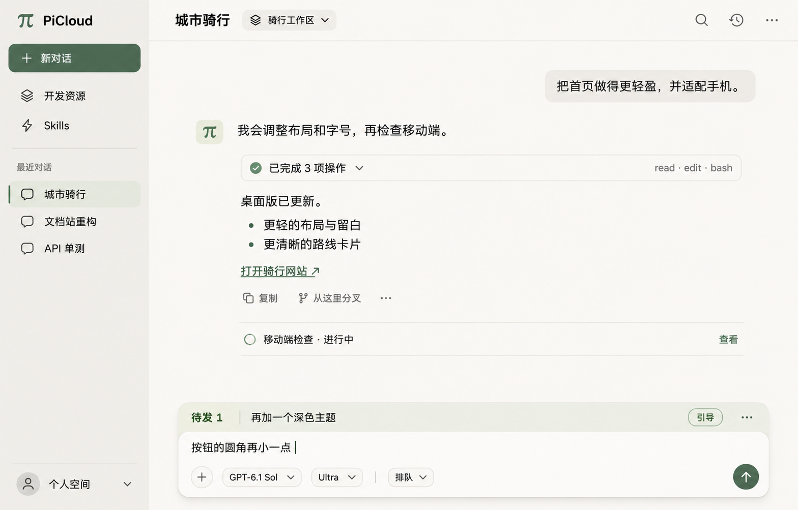
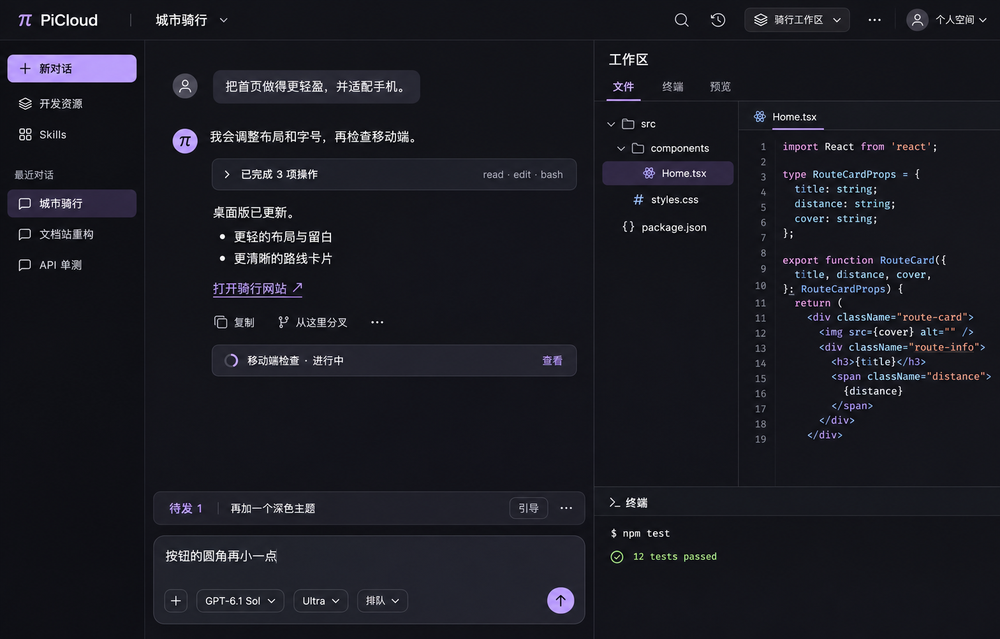

# PiCloud UI concepts — 2026-11-04

状态：视觉与信息架构提案，等待维护者选择。基线为 `1ae43c02`。
本分支只保存设计图、生成提示词与调研记录；没有应用代码改动或部署。
三张图都使用虚构的“城市骑行”任务，不包含真实会话、用户文件或账号。

## 三个方向

| 方案 | 侧重点 | 更适合 | 主要取舍 |
| --- | --- | --- | --- |
| A · 浅色对话 | 暖白、鼠尾草绿、宽阅读区；工作面板按需打开 | 长会话、日常编码交流 | 查看文件或应用时需要展开面板 |
| B · 深色工作台 | 石墨灰、淡紫；对话与只读代码、终端并排 | 编码、排障、核对执行结果 | 信息密度更高，窄屏需收起右栏 |
| C · 预览工作室 | 冷白、蓝；收起会话导航，应用预览占主要空间 | 前端应用、网页和交互迭代 | 聊天阅读区较窄，内嵌预览尚需专项验证 |

### A · 浅色对话

### B · 深色工作台

### C · 预览工作室

布局与配色可以分别选择。建议以 A 的简洁结构作为默认入口；
深色可采用 B 的配色，C 可作为主动打开预览后的工作布局。
这是设计判断，尚未做用户测试。

## 参考与观察

调研日期：2026-11-04。来源是产品官方文档与公开展示；不是各版本的完整实机验收。

| 产品与来源 | 已核对的交互 | 在 PiCloud 中的设计推论 |
| --- | --- | --- |
| [Codex / ChatGPT 桌面端](https://learn.chatgpt.com/docs/features)、[Review pane](https://learn.chatgpt.com/docs/code-review?surface=app) | 项目/会话入口与专门的代码审阅区域；审阅动作有独立承载面板 | 给正文、导航、工作面板分配清晰职责；不据此新增 PiCloud Diff/PR 工作流 |
| [Claude Code Desktop](https://code.claude.com/docs/en/desktop#arrange-your-workspace) | 对话、文件、终端、浏览器等面板可按需要显示；会话详情栏可隐藏 | 把低频信息收进可打开的面板；对话正文保持连续阅读 |
| [Lovable editor](https://docs.lovable.dev/features/projects/editor)、[Quick start](https://docs.lovable.dev/introduction/getting-started) | 左侧对话、右侧真实应用预览；顶栏提供工具与溢出菜单 | C 将应用效果作为主要工作画布；保留 PiCloud 已有对话和输入语义 |
| [Manus 官方介绍](https://manus.im/docs/introduction/welcome) | 以完成任务和交付工作成果为中心，使用独立计算环境 | 输出与工作成果应容易找到；不向 PiCloud 默认聊天页添加运维控制台 |

另检查了 Lovable 官方 Dashboard 展示图，以及 PiCloud 既有浏览器验收截图。
第三方截图只作为本地研究参考，未重新发布到本分支。
Manus 产品博客后续读取不稳定；本提案不把其某个版本的具体面板位置作为已确认事实。

当前 PiCloud 源码中的观察点：

- `ChatApp.tsx` 同时承载会话列表、历史树、正文和工作区；历史树展开时会占用第二列。
- 顶栏包含定时任务、代码托管、下载、搜索、工具分组、工作区等多个入口，主次不够突出。
- `product.css` 有大量相近深灰背景与细边框；字体、间距和状态强调需要形成一致层级。
- 待发队列、模型设置、工具摘要和消息操作已有完整行为，可通过视觉整理减少操作负担。

以上属于设计观察，不能由静态截图推导当前滚动性能或运行故障。

## 三版共同保留的交互

- 会话列表中的子 Agent 默认收起；人工 Fork 保持平级。历史树改为按需打开。
- 初始消息直接进入正文，展示本地发送状态；收到持久化回执后才显示已发送。
  steer/follow-up 继续使用当前会话的待发队列。
- Enter 默认排队，可切换为引导；每条待发消息可以引导、编辑、取消和调整顺序。
  图中将低频操作收到溢出菜单；正式实现仍需完整保留键盘与触屏入口。
- 输入框有内容时主按钮发送；空输入且运行中时主按钮停止。停止后的待发内容返回编辑。
- 工具组默认收起，全局控制只改变分组展开方式；单项详情独立展开。
  错误只强调出错项，最终结果替换临时预览，重试使用一条更新的状态行。
- 复制、从这里分叉与更多操作使用同一基线和视觉样式。
- 子 Agent 进度保持简短，主动委派策略沿用 Ultra；不强迫主页面展开子 Agent 正文。
- `/usage`、`/compact`、图片上传/展示、组织 Skills 和开发资源入口保留。
- 预览链接来自已有 Preview 能力。聊天中不额外生成重复的“打开应用”卡片。

## 需要额外设计的部分

A 主要是现有页面的布局、主题与入口整理。B 的文件/终端组合排列是新的表现方式，
文件内容继续只读。C 的内嵌应用预览是提案，目前产品使用独立认证预览链接；
图中的“预览”标签不表示该面板已经实现。

如果选择 C，需要验证认证预览在内嵌场景的可用性、隔离、HTTP/WebSocket、
重新加载和新窗口打开；不能把工作区 HTML 文件直接作为应用预览执行。
不适合内嵌时继续使用已有的新窗口入口。桌面/手机图标只切换预览宽度，
不代表新增手机沙箱或设备能力。

Skills、资源管理、模型选择弹层以及登录页，应在选定方向后沿用同一组视觉变量。
当前图没有增加审批、连接器市场、Git Diff 编辑、版本回滚或发布系统。

## 后续验收草案

- [ ] 维护者选择默认布局与配色，确认预览是默认区还是可选面板。
- [ ] 补充发送中、离线、重连、请求失败、工具 UNKNOWN、队列为空等状态稿。
- [ ] 补充窄屏布局；正文、队列、发送/停止按钮和弹出菜单保持可用。
- [ ] 使用真实浏览器验证文字选择、历史分页、返回最新、工具展开和滚动锚点。
- [ ] 核对现有功能入口，避免视觉精简造成能力丢失。
- [ ] 选型之后再制定实现切片和验收；本次不修改运行时协议。

## 生成与检查

使用内置 `image_gen` 生成 A/B/C；C 追加一次编辑，移除重复导航并重新排布聊天区。
[prompts.json](prompts.json) 保存完整提示词，[images.json](images.json) 保存尺寸和校验值。
每张图为 1568 × 1003 PNG；已检查中文、主布局、功能入口与虚构内容。
它们是视觉概念图，不能替代像素规格、代码校验、对比度测量或交互验收。
